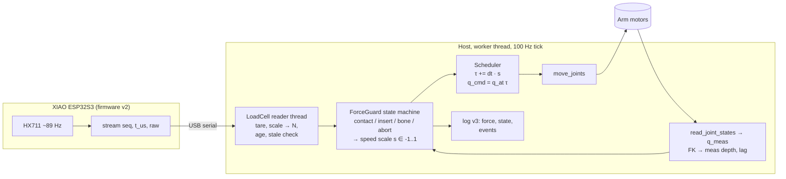
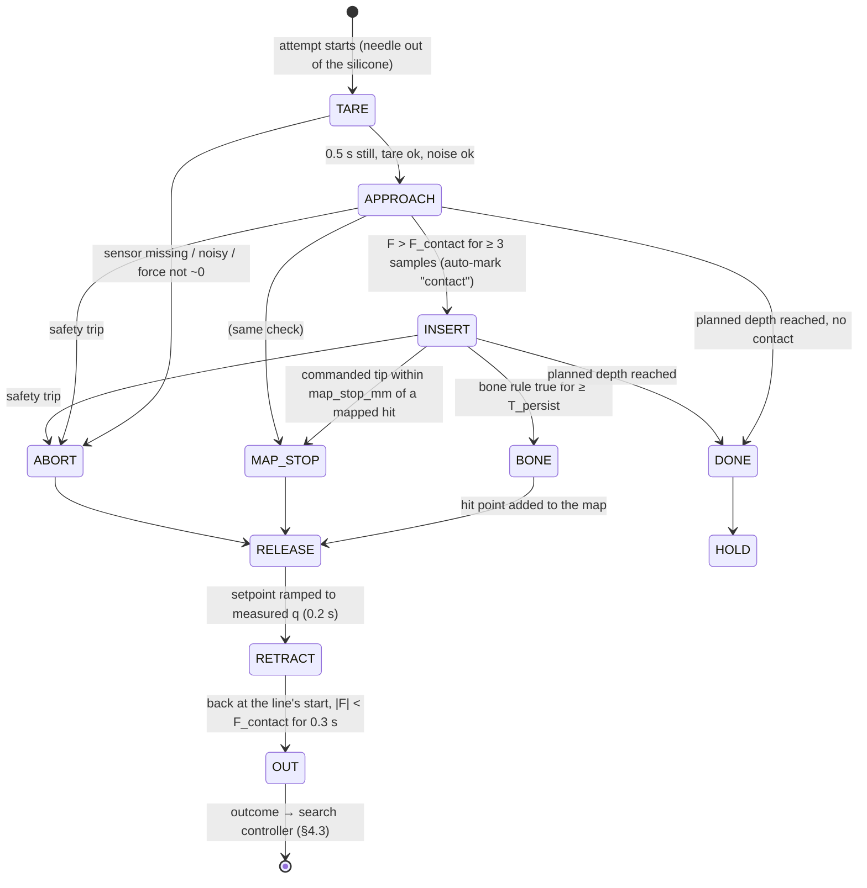
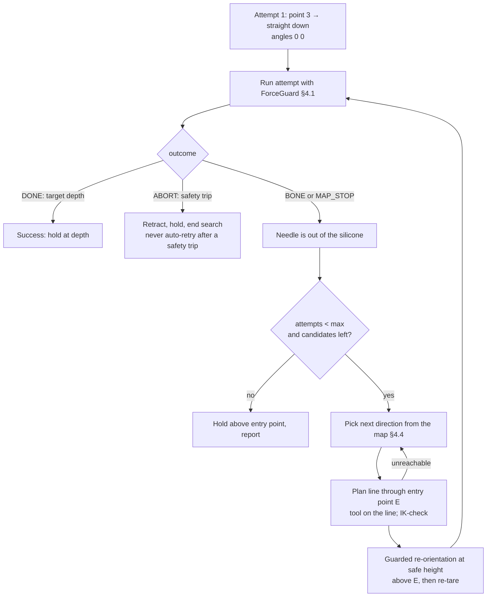

# Load-Cell Force Feedback for Needle Insertion — Integration Plan

Status (2026-10-12): **Phases 1, 2, 5, 6 and 7 are implemented and tested in
sim; Phase 0 is partly done.** The Phase 3 tooling is ready, but the data
collection needs the arm. The Phase 4 replay tool is ready, but tuning needs
that data. The real board and real arm are not tested yet.
How to use it, test results and limitations:
[10_loadcell_force_feedback.md](10_loadcell_force_feedback.md).

**End goal of the experiment.** Start straight down (angles `0 0`) into the
silicone block. If the needle hits bone (PLA), retract it **fully out of the
silicone**, tilt it a little about the **same entry point**, and advance again.
Repeat until the needle reaches its target depth or the search gives up. Every
bone hit is stored in an **occupancy map**, so no later attempt is allowed to
drive the needle into a known bone region. It stops before it gets there.

## 1. Why this change

The original goal was to detect when the needle hits bone from the change in
each joint's motor torque. The plunger experiments (`recordings/plunger/`,
2026-10-06) showed that this doesn't work. Even with the needle pressed 15–24 mm
"behind" its commanded position, joint2's reported torque only ranged from
−1.15 to −0.99 Nm, which is lost in gravity load and friction.

The gripper has been removed. A single-axis load cell (1 kg, HX711, XIAO
ESP32S3) now sits in series with the syringe holder, so it measures the axial
needle force directly. This plan covers how that force gets into the 100 Hz
control loop that drives plunger point 4 (the descent).

## 2. What the data says so far

Source: `new_setup&files/arm_loadcell/recordings/` and `analysis/experiment_analysis.md`,
plus a quick re-analysis done for this plan:

| Run | Condition | Baseline noise (sd, counts) | Baseline after run | Peak | Mean rise (onset→peak) |
|---|---|---:|---:|---:|---:|
| 1 | silicone | 22.5 k | +57 k | 1.96 M | 0.58 M/s |
| 2 | silicone | 12.6 k | +40 k | 2.16 M | 0.64 M/s |
| 3 | silicone | 13.2 k | +33 k | 4.01 M | 0.30 M/s |
| 4 | PLA bone | 6.4 k | +10 k | 4.35 M | 0.54 M/s |
| 5 | PLA, **bracket broke** | 25.6 k | +108 k | 4.35 M | 1.88 M/s |

Conclusions that drive the design:

1. **Contact is easy to detect.** Loads are millions of counts and noise is
   about 10–25 k counts, so a threshold around 100 k counts is more than 5 sd
   above noise and still under 5 % of a typical peak.
2. **Peak force alone does not separate bone from silicone.** Silicone run 3
   reached 4.01 M and PLA reached 4.35 M, an 8 % gap based on one PLA trial.
   A plain threshold would either miss bone or stop in soft tissue.
3. **Time is the wrong x-axis.** These recordings have no depth, speed or
   contact timestamps. Bone should show up as **force rising steeply per
   millimetre of needle travel** (high stiffness) while the needle stops
   advancing. Measuring that needs force and depth logged on the same clock.
   Getting that data is the first job (Phase 3).
4. **The baseline drifts 10–110 k counts per run.** The host must tare
   immediately before every descent, at the descent pose. The syringe weight
   on the cell depends on orientation.
5. **The bracket failed at about 4.35 M counts.** Until it is reinforced, every
   force limit must sit well below that.
6. **The load cell may already be overloaded (estimate, needs calibration).**
   The HX711 is ratiometric. At gain 128, a cell with sensitivity S (mV/V)
   gives about `S × 2.15 M` counts at rated load, whatever the supply voltage.
   Most 1 kg bar cells are about 1.0 mV/V, so 1 kg ≈ 2.15 M counts ≈ 219 k
   counts/N. If that holds, the PLA and bracket-failure peaks (4.35 M) were
   about **2 kg on a 1 kg cell**. Typical safe overload is 120–150 %. Check the
   cell's datasheet and calibrate (Phase 2). If confirmed, use a 3 kg or 5 kg
   cell.

### The arm is a soft spring, and that matters

In the old plunger logs the commanded depth ran **13–24 mm ahead of the
measured depth** once the needle met resistance (`hard_serface.csv`: 15.7 mm at
the end; `sillicon.csv`: 24.0 mm). With kp = 20–40 Nm/rad, the position loop
behaves like a spring of very roughly a few hundred N/m at the needle tip. This
has three consequences:

- **The needle force is roughly `K_arm × (commanded − measured depth)`.** Just
  freezing the command on bone keeps pushing with whatever spring force has
  built up. A real stop must also **move the setpoint back to the measured
  position** to release that stored force.
- **The lag is a free second force signal.** It comes from joint encoders the
  code already reads, and it is useful as a cross-check on the load cell.
- **Fast force loops are not possible.** The outer force loop has to run much
  slower than the compliant position loop, sensor latency and the 89 Hz sample
  rate. Speed governing at about 1–2 Hz bandwidth is fine. A stiff force servo
  is not.

## 3. Current control loop (from the code)

`new_setup&files/current_control.xml` only contains one label ("current motor
readings"), so this diagram is reconstructed from the code. Point 4 is
`mode_plunger._point4()` → `mode_line._execute()`:

```mermaid
flowchart LR
    P[Planner<br/>_plan_section: IK knots<br/>every 2 mm, tool down] --> S
    S[Scheduler<br/>_q_at(t): wall-clock time<br/>→ joint setpoint] --> M[move_joints<br/>MIT: kp, kd, q, tau_g]
    M --> A[(Arm motors<br/>CAN, 100 Hz)]
    A -->|q, torque| L[_PlungeLog.sample<br/>logged only]
    G[GUI Mark button] -.->|manual time stamp| L
```

It is **open loop with respect to the task**. The path is a fixed function of
wall-clock time, and the measured state is only logged. Nothing that is
measured can slow, stop or reverse the needle.

## 4. Target control loop



The key change is in the **scheduler**. Instead of `q = q_at(wall_time)`, it
keeps its own path time `τ` and advances it by `dt × s` on every tick, where `s`
comes from the guard:

| `s` | Effect |
|---|---|
| 1 | Normal planned speed |
| 0 < s < 1 | Slowed down by rising force |
| 0 | Hold position |
| −1 | Run the same planned knots **backwards**, which is a retract along exactly the same line, with no new IK |

This keeps the existing guarantee that a late tick lands where the path should
be, with no burst of catch-up waypoints. When `s ≡ 1` it reduces exactly to
today's behaviour.

### 4.1 ForceGuard state machine (one attempt = one straight line)



| State | Speed scale `s` | Exit condition |
|---|---|---|
| TARE | 0 | Median of 0.5 s of samples becomes zero. Refuse if sd > `noise_max`, there are no samples, or the raw value is far from the previous tare (the needle may still be in the material). |
| APPROACH | `v_approach / v_plan` | `F > F_contact` for 3 consecutive samples |
| INSERT | `clamp((F_soft − F)/(F_soft − F_contact), s_min, 1) × v_insert/v_plan` | Bone rule, map stop, planned depth, or safety |
| BONE / MAP_STOP / ABORT | 0 | Event logged (BONE also adds the hit to the map), then RELEASE |
| RELEASE | 0, with the setpoint ramped from q_cmd to q_meas over about 0.2 s | Ramp done |
| RETRACT | −`v_retract/v_plan`, the whole way back to the line's start, which is above the surface | Tip at the line start **and** \|F\| < `F_contact` for 0.3 s, which confirms the needle is out of the silicone |
| OUT | 0 | Hands the outcome (`bone`, `map_stop`, `abort`) to the search controller |
| HOLD / DONE | 0 | Target depth reached. Hold there (`on_success: hold`). |

Withdrawing through silicone pulls the syringe, which gave −1.6 M to −2.3 M
counts in runs 1–3. So during RETRACT, `F_pull_abort` is off and the "out"
check waits for the force to come back to about zero.

**Bone rule.** This is the first candidate. The thresholds get fitted in
Phase 4 on new synchronized data, not on the five recordings above.

```
bone  =  F > F_bone_min
     AND ( k_local > k_bone           # stiffness dF/dz over the last ~0.5 mm of measured depth
        OR stall )                    # measured depth rate < 25 % of commanded while F rising
     held continuously for ≥ T_persist   (≈ 100–150 ms)
```

A rule based on continuous exceedance, rather than total time above a
threshold, is what `experiment_analysis.md` recommends: silicone run 3 crossed
4 M counts for only 3 samples.

**Safety trips.** These are always active, independent of the bone rule, and
any one of them goes to ABORT:

| Trip | Default | Why |
|---|---|---|
| `F > F_abort` | Below 70 % of the bracket-failure level until the bracket is rebuilt (≈ 3.0 M counts raw, convert after calibration) | Protects the bracket and load cell |
| `F < −F_pull_abort` | ≈ 1.0 M counts | Needle snagged or pulled sideways. Silicone runs went to −2.3 M on withdrawal, so this is **not** checked during RETRACT. |
| Sensor stale > 100 ms, serial error, or sequence gap > 5 | — | No force signal means no motion |
| Lag `cmd − meas depth` > `lag_max` | ≈ 20 mm | Independent check on the load cell, since the arm is fighting something |
| Planned depth + margin exceeded | — | Already enforced by the plan |

GUI Stop keeps working exactly as it does now (KeyboardInterrupt in the
worker).

### 4.2 Latency budget

| Source | Typical |
|---|---|
| HX711 sample period (89 Hz) | ≤ 11 ms |
| HX711 step settling at 80 SPS (datasheet) | ~50 ms to full value |
| USB CDC + parse | 1–3 ms |
| Control tick | ≤ 10 ms |
| Persistence window (3 samples) | ~34 ms |

At 2 mm/s the needle travels about 0.2 mm in that time, which is negligible.
The stored spring force from the arm's lag dominates, which is why RELEASE
matters more than shaving milliseconds.

### 4.3 Bone-avoidance search (the outer loop over attempts)



**Entry point E.** In attempt 1, E is the needle-tip position (FK of the
measured q) when CONTACT fires, so it is a point on the silicone surface. Every
later attempt is a straight line **through E**, entering the same hole at a
new angle. If contact on a later attempt happens more than `entry_tol_mm` from
E, the system warns that the block may have moved.

**Geometry of attempt k** (direction `d_k` from `(tilt, rot)`, using line
mode's convention `d = (sin t cos r, sin t sin r, −cos t)`):

| Point | Formula | Meaning |
|---|---|---|
| Line start `S_k` | `E − d_k · h_safe / cos(tilt)` | Tip starts `h_safe` above the surface, on the line |
| Line end `T_k` | `E + d_k · L_insert` | Target. `L_insert` = attempt 1's depth below E (`--depth` minus the point 3 → E stand-off), kept the **same along the needle** for every tilt. |

**Full retract and re-direct (transit).**

1. RETRACT runs the current line backwards to `S_k`, so the needle is out.
   Attempt 1 retracts to point 3.
2. Plan attempt k+1 with the same planner as point 3, `_plan_oriented()`: a
   joint-space move to `S_{k+1}` that arrives with the tool already on the new
   line, followed by the line itself. If IK fails (joint6 is only ±45°),
   discard that candidate and pick the next. **Planning happens while the
   needle is out and the arm is held, never inside the silicone.**
3. Joint-space moves don't keep the tip on a straight path. Sample the FK of
   the transit move and **refuse it if the tip comes within `h_min` of the
   surface height `z_E`**. If that happens, raise `h_safe` and re-plan.
4. Run the transit through the same governed executor in APPROACH-only mode.
   Any force above `F_contact` during the transit is an ABORT, because it
   means the needle touched something it shouldn't have.
5. Hold still, re-tare (the syringe's weight on the cell changes slightly
   with tilt), and start attempt k+1.

**When the search ends:**

- Success when an attempt reaches `T_k` with no bone.
- Give up after `max_attempts` (default 6), or when every candidate up to
  `max_tilt_deg` (default 20°) is blocked by the map or unreachable. The
  needle then holds at `S_k`, out of the silicone.
- Any safety trip (`F_abort`, a stale sensor, `lag_max`, the transit touching
  something) ends the search immediately after RELEASE and RETRACT. Only
  BONE and MAP_STOP lead to another try.

### 4.4 Occupancy map

**What it stores.** Each BONE event adds the needle-tip position at detection
(FK of the measured q, robot_base frame) as a **hit**. It is treated as a
sphere of radius `hit_radius_mm` (start at 3 mm, tuned in Phase 6). The file
also records E, the surface height `z_E`, and for information only, the lines
that reached depth and the attempts that were stopped.

```jsonc
// recordings/maps/<map_name>.json — one per phantom setup
{
  "version": 1, "name": "block_A", "created": "2026-10-12T15:30:00", "arm": "right",
  "entry_point_m": [0.200, -0.095, 0.214],
  "hit_radius_mm": 3.0,
  "hits":   [{"xyz_m": [0.200, -0.095, 0.196], "force_n": 12.4, "attempt": 1, "session": "20261012_153000", "dir_deg": [0, 0]}],
  "clear_lines": [{"from_m": [...], "to_m": [...], "dir_deg": [10, 135]}]
}
```

**Lifetime is per session/phantom setup.** Choose the map with `--map NAME`.
It is loaded at start and saved after every hit, so a crash can't lose one.
`--map-new` (or the GUI's **Clear map**) starts a fresh map. **Clear it
whenever the block is moved.** Hits are in robot_base coordinates, so a moved
block makes them wrong. The entry-point check in §4.3 catches the case where
the block moved but the map wasn't cleared.

**Using the map to choose a direction.** This is the search in §4.3.

1. Candidates are `(tilt, rot)` for tilt ∈ `tilt_steps_deg` (5, 10, 15, 20)
   and rot every `rot_step_deg` (45° gives 8 per ring), plus `(0, 0)`.
2. A candidate is **blocked** if the needle segment `S_k → T_k` passes within
   `hit_radius_mm + line_margin_mm` of any hit. The test is the distance from
   each hit point to the segment.
3. Of the unblocked candidates, rank by **smallest tilt** first, then **largest
   clearance** to the nearest hit. Break remaining ties by pointing away from
   the hits' mean sideways offset from E.
4. Plan the best one. If it is unreachable, go to the next.

Example: a hit 18 mm straight below E with a 3 + 1 mm margin needs
`tan(tilt) ≥ 4/18`, so tilt ≥ 12.5°. The 5° and 10° rings are blocked and the
first 15° candidate gets planned. The map picks the needed tilt by itself.

**Using the map to stop before a known hit (MAP_STOP).** On every INSERT and
APPROACH tick, find where the current line first enters any inflated hit
sphere. If the **commanded** tip is within `map_stop_mm` of that point, stop
(MAP_STOP → RELEASE → RETRACT). The commanded tip is used rather than the
measured one because it runs ahead of the measured tip (arm lag), so this
errs on the safe side. The needle never physically reaches a known bone
region again. That includes a re-run of the same straight-down line in a later
session with the same map. This deliberately exercises the map: attempt 1
still runs straight down as requested, and the map stops it short.
`--map-skip-blocked` instead starts the search from the first unblocked
direction.

**Accuracy limits** (these set `hit_radius_mm`):

- The hit position comes from joint encoders plus FK. It doesn't see bracket
  or link flex, or the **needle bending** inside the silicone, which can be
  several mm for a thin needle.
- Phase 6 measures this spread: hit the same bone straight down 5 times with
  the map in record-only mode. Set `hit_radius_mm` to at least the spread of
  the hit positions plus 1 mm.

## 5. Implementation phases

Each phase ends with something testable. Do not run the closed loop (Phase 5)
on the real arm before Phases 0–4 pass.

### Phase 0 — Mechanics and the arm model (before any software)

1. **Rebuild or reinforce the load-cell bracket.** Run 5 broke it. Aim for the
   bracket to survive at least 2× `F_abort`.
2. **Check that the load-cell axis lines up with the syringe and needle axis.**
   It is a single-axis cell, so off-axis loads cause bending and crosstalk. The
   needle axis must be the tool axis the IK holds straight down.
3. **New TCP = needle tip.** Get the offset from the mounting flange to the
   needle tip from the CAD (`arm_with loadcell.step`) and check it with
   calipers. Make a copy, `sim_files/udrf/openarm_dual_needle.urdf`, which:
   - removes the finger links and joints,
   - adds a fixed `openarm_{side}_needle_tip` link at the measured offset,
     oriented so that −X still points along the needle (`TOOL_AXIS` stays the
     same),
   - updates the hand/tool `<inertial>` with the mass and centre of mass of the
     load cell, holder and syringe (weigh it, take the CoM from CAD).
     Gravity compensation (`joint_tauG_enable` is all 1s) currently assumes the
     gripper's mass.

   Point `paths.urdf` at the new file. Update `kinematics.TCP_LINKS` to the new
   link names. Both roboticstoolbox (kinematics) and Pinocchio (dynamics) read
   the same URDF, so this is one change for both.
4. **Gripper motor removed.** `ArmController.__init__` still calls
   `init_gripper_motor()`. `read_joint_states()`, `zero_torque()` and
   `query_params()` still talk to motor 0x08. Add `motors.gripper.enabled:
   false` to the config, skip all gripper I/O when it is false, and hide the
   GUI's gripper controls.

**Done when:** `plunger --point 3/4 --dry-run` plans with the new TCP, and the
arm floats in limp/record mode without drifting (this confirms the new mass
model).

### Phase 1 — Firmware v2: continuous stream

Add a new sketch, `loadcell_stream/loadcell_stream.ino`. Keep
`loadcell_raw.ino` unchanged so the standalone `recorder.py` still works.

- On boot and on `hello`: `# LOADCELL v2 hx711 gain128` (lets the host
  identify the port).
- `stream on` / `stream off`. While on, send every conversion as
  `<seq>,<board_us>,<raw>\n`. `seq` is a 32-bit counter, so the host can see
  dropped samples. `board_us` is `micros()`.
- Keep reading conversions while idle, as now.
- Send `# ERR not_ready` if no conversion arrives for more than 200 ms (the
  current code waits 2 s).
- **No tare or scaling on the board.** The host keeps raw values so the logs
  can always be re-analysed.

At about 89 Hz × ~22 bytes ≈ 2 kB/s, 115200 baud is ample.

**Done when:** a 10-minute stream shows no sequence gaps and an average rate
of 85–90 Hz.

### Phase 2 — Host driver and calibration: `src/comm/loadcell.py`

```python
class LoadCell:
    def __init__(self, port, baud=115200, scale_counts_per_n=None, sign=+1): ...
    def start(self) / stop(self)          # background reader thread + serial
    def latest(self) -> Sample            # seq, board_t, host_t, raw, force_n, age_s
    def window(self, seconds) -> ndarray  # ring buffer for tare / noise / plots
    def tare(self, seconds=0.5) -> TareResult   # median offset, sd, n
    healthy: bool; error: str | None
class FakeLoadCell:                       # same interface; force from a depth model (see Phase 5)
```

- The reader thread only touches serial, never CAN, so it fits the GUI's
  threading model (`gui/backend.py`). `latest()` is lock-protected for the
  worker and GUI threads.
- Add `Session.loadcell()`, cached like `Session.real()`, and close it in
  `Session.close()`.
- `pyserial` is **not installed** in the system Python. Add it to the
  project's requirements.
- CLI: `python3 comm/loadcell.py monitor | noise | tare | calibrate`.

**Calibration** (`calibrate`): mount the tool as used, pointing down. Tare,
then apply known loads **along the needle axis**. Either hang 50/100/200/500 g
masses from the needle hub, or (often easier) jog the arm down so the needle
hub presses on a kitchen scale. Fit a straight line, report counts/N, sign and
the linearity residual, and write the result to the `loadcell:` config. This
also settles the overload question in §2.6.

New config section in `config.yaml`:

```yaml
loadcell:
  enabled: true
  port: auto                  # or /dev/ttyACM0; auto = first port answering "# LOADCELL v2"
  baud: 115200
  scale_counts_per_n: null    # from `loadcell.py calibrate`; null = work in raw counts
  sign: 1                     # +1 when pushing the needle in gives positive force
  stale_ms: 100
  tare_s: 0.5
  noise_max: 30000            # counts sd allowed during tare
guard:                        # values in N once calibrated (raw counts until then)
  F_contact: 100000
  F_soft: null                # Phase 4
  F_bone_min: null            # Phase 4
  k_bone: null                # Phase 4, N/mm
  T_persist_ms: 120
  F_abort: 3000000
  F_pull_abort: 1000000
  lag_max_mm: 20
  v_approach_mm_s: 2.0
  v_insert_mm_s: 1.0
  v_retract_mm_s: 2.0
  on_bone: retract_out        # retract_out (fully out, then stop) | hold | search
  on_success: hold            # hold at target depth | retract_out
search:                       # §4.3–4.4, used when on_bone = search (Phase 6)
  tilt_steps_deg: [5, 10, 15, 20]
  rot_step_deg: 45
  max_tilt_deg: 20
  max_attempts: 6
  h_safe_mm: 15               # tip height above the entry point while re-orienting
  h_min_mm: 5                 # transit path must keep the tip at least this far above z_E
  entry_tol_mm: 3.0           # contact this far from E -> warn "block moved?"
  out_hold_s: 0.3             # |F| < F_contact this long = needle is out
map:
  dir: recordings/maps
  hit_radius_mm: 3.0          # Phase 6 sets this from the measured hit spread
  line_margin_mm: 1.0         # extra clearance when choosing a direction
  map_stop_mm: 2.0            # stop this far before an inflated hit
  skip_blocked: false         # true = don't run a first direction the map already blocks
```

**Done when:** calibration is linear within about 2 % of full scale, and
`monitor` shows a known weight correctly at several tool orientations after
re-taring.

### Phase 3 — Synchronized logging, open loop (data collection)

Use the existing motion with **no feedback**. The guard runs in a mode that
only logs (`--guard log`) and reports what it *would* have done. This produces
the dataset the analysis says is missing.

- Plunger log **v3**. Same file, more columns:
  `force_raw, force_n, force_age_ms, force_seq, lag_mm, guard_state, guard_s`.
  New header lines: `# loadcell: scale … sign … tare_raw … tare_sd …` and
  `# events_s: contact 3.12 would_bone 9.80 …`. Manual Marks stay as they are.
- Sample the force inside the same tick, right after `move_joints`, from
  `LoadCell.latest()` (non-blocking). Do one `read_joint_states()` per tick and
  share it between the log and the guard. FK runs per tick, so time
  `km.fkine()` at 100 Hz, which today only runs offline in `save()`.
- **Experiment protocol.** Use the same needle, the same tool-down pose and a
  fixed speed (start at 1 mm/s) every time. Run ≥ 5 silicone-only trials and
  ≥ 5 silicone-over-PLA trials, each with a fresh tare. Note needle gauge,
  sample and any fixture change in `--name`. Set `--depth` so the needle can
  physically reach the PLA, and keep `F_abort` active the whole time (Phase 5's
  abort path can be enabled on its own first, see below).

**Done when:** you have ≥ 10 logs whose force-versus-measured-depth curves can
be overlaid.

> Recommended order: implement the **safety trips and RELEASE/RETRACT only**
> (Phase 5 minus the bone rule) before collecting PLA data. That way the data
> collection itself cannot break the bracket again.

### Phase 4 — Design the detector offline

Add `src/test_scripts/replay_force_guard.py`. It feeds v3 logs through
`ForceGuard` exactly as the live loop would, tick by tick, and prints or plots
when each state would have fired.

- Plot force against **measured depth** for every trial. Compare stiffness
  `k = dF/dz` and stall behaviour between silicone and PLA. This decides
  between the stiffness, stall and absolute-force parts of the bone rule.
- Fit thresholds on half the trials and **test on the other half**. Report
  missed bones and false stops in silicone.
- Choose `F_soft` so INSERT slows clearly before `F_bone_min`.
- `ForceGuard` lives in `src/motion/force_guard.py` and is **pure logic, with
  no I/O**:
  `update(t, force_n, age_s, cmd_depth_mm, meas_depth_mm) -> (state, s, event)`.
  The same code runs offline, in sim and on the real arm.
- Unit tests use synthetic traces (ramp, step, noise, stale, sequence gap) and
  every recorded trial.

**Done when:** the held-out trials show zero missed bone contacts and false
silicone stops you can live with.

### Phase 5 — Closed loop in plunger point 4

1. In `mode_line._execute()`, add an optional `governor(t_wall, q_meas) ->
   (s, event)` argument and a path time `τ` advanced by `dt × s`. With no
   governor the behaviour is identical to today. Line mode doesn't change. Add
   `_q_at` support for backwards travel (retract) and for a ramped hold target
   (RELEASE).
2. Changes to `mode_plunger._point4()`:
   - Open the load cell via the Session (it refuses to start if it's missing
     or unhealthy when `--guard` isn't `off`).
   - Hold still for TARE, then build `ForceGuard` from the `guard:` config and
     flag overrides, and pass it as the governor.
   - New flags: `--guard {off,log,on}` (default `on` once validated, `log`
     until then), `--on-bone {retract_out,hold}` (`search` arrives in Phase
     6), `--f-abort`, `--f-contact`.
   - On BONE, RETRACT goes **all the way back to point 3** and confirms the
     needle is out (§4.1). Phase 6 builds on this.
   - The planned `--depth` stays as a **hard maximum**. The guard can only stop
     earlier or go backwards, never further.
3. **Sim test first.** `FakeLoadCell` produces force from the *measured* sim
   depth using a piecewise model: free air, then silicone stiffness from
   `surface_mm`, then bone stiffness from `bone_mm`, plus recorded noise. Run
   `plunger --point 4 --mode sim --guard on --loadcell fake` and check that
   CONTACT, BONE, RELEASE and RETRACT happen at the modelled depths.
4. **Real arm, in this order:**
   - Free air: no contact event, and the arm reaches full depth.
   - Press the syringe by hand: ABORT, then RELEASE, then RETRACT.
   - Unplug the USB mid-descent: stale ABORT.
   - Foam.
   - Silicone (should reach full depth or stop only at `F_abort`).
   - Silicone over PLA (BONE, then a full retract out of the block).

**Done when:** BONE fires on every PLA trial with no bracket damage, no false
BONE happens in silicone-only trials, and every retract ends with the needle
confirmed out.

### Phase 6 — Bone-avoidance search and occupancy map

Build on Phase 5. Everything is described in §4.3–4.4.

1. **`src/motion/occupancy_map.py`**, pure apart from JSON load/save.
   `OccupancyMap.load/new/save`, `add_hit(xyz, info)`,
   `segment_clearance(p0, p1)`, and `first_entry(p0, d)`, which gives the
   distance along a line to the first inflated hit (used for MAP_STOP).
   Unit-test it with hand-placed hits.
2. **`src/motion/direction_search.py`**, pure. Generates candidates, filters
   out blocked ones, ranks the rest (§4.4), and builds `S_k`/`T_k` from E.
3. **`ForceGuard`** gets the MAP_STOP check. It takes the map and the current
   line, and checks the commanded tip each tick. This is cheap: a few
   point-to-line distances.
4. **`mode_plunger._point4()`** gets the search loop, enabled by
   `--search` (or `on_bone: search`):
   - Attempt 1 is today's point 4 (straight down from point 3, angles
     `0 0`). Optional `--angles TILT ROT` sets a different first direction.
   - It records E at the first CONTACT.
   - On BONE or MAP_STOP: full retract, pick the next direction, plan, check
     the transit clearance, run the guarded transit, re-tare, run the next
     attempt.
   - Flags: `--map NAME`, `--map-new`, `--map-skip-blocked`,
     `--max-attempts`, `--max-tilt`.
5. **Logs.** Each run gets one folder, `recordings/search/<stamp>_<name>/`,
   containing:
   - `attempt_01.csv` and so on, each in plunger log v3 format plus
     `attempt, tilt_deg, rot_deg` header lines,
   - a `map.json` snapshot taken after the run,
   - `summary.csv` with one row per attempt: direction, contact xyz, outcome
     (`done | bone | map_stop | abort | unreachable`), hit xyz, max force,
     and depth reached.
6. **Sim first.** Place `FakeLoadCell`'s bone as a sphere or slab in the
   model. Check four things:
   - The search finds an unblocked direction.
   - MAP_STOP fires before the modelled bone when the same line is re-run.
   - The transit check rejects a path that dips into the block.
   - Unreachable candidates are skipped.
7. **Real-arm order:**
   - **Hit-spread test.** Straight down, map record-only, 5 hits on the same
     PLA spot. Set `hit_radius_mm` from the result.
   - **MAP_STOP test.** Re-run straight down with that map. It must stop
     about `map_stop_mm` short with no bone force.
   - **Full search.** PLA bone placed so straight down hits it and a 10–20°
     tilt misses it.

**Done when:** in ≥ 5 full-search trials, every bone hit is followed by a
confirmed-out retract and a new direction. No attempt touches a mapped hit
(no BONE within `hit_radius_mm` of an existing hit). The search ends at
target depth, or gives up cleanly, out of the block.

### Phase 7 — GUI

In the Plunger tab:

- Live force plot (N, or counts before calibration) next to the existing
  plots, using `gui/plots.py`. Show the `F_contact`, `F_soft` and `F_abort`
  lines, plus the guard state as a coloured badge (TARE / APPROACH / INSERT /
  BONE / ABORT / HOLD).
- Load-cell status: port, Hz, age, healthy. Buttons: Connect, Tare, Calibrate…
- Guard settings with spin boxes bound to the `guard:` config (saved through
  `user_config.yaml`, like the other settings).
- Contact and bone events appear in the marks label automatically. The manual
  Mark button stays.
- **Search and map panel.**
  - Map picker, New map, Clear map, and a search on/off switch.
  - Settings: max attempts, max tilt, hit radius, map-stop distance.
  - The current attempt number and direction.
  - A **map view** with two 2D projections, top (x–y) and side (along the
    current rot). It shows E, the hit spheres, every attempt's line coloured
    by outcome, and the candidate directions (blocked ones greyed out).
    This uses the existing 2D view in `gui/plots.py`, so no 3D library is
    needed.
- The GUI reads `LoadCell.latest()` directly. The serial thread is separate
  from CAN, so this doesn't break the worker-only-CAN rule.

### Phase 8 — Optional: force-regulated insertion

Once Phase 5 is reliable, INSERT can go from speed limiting to **force
regulation**. This is an admittance outer loop, `v = clamp(v_insert + K_f
(F_target − F), 0, v_max)`, at less than about 2 Hz bandwidth because of the
compliant inner loop and sensor latency. The motor torques and the lag signal
can be combined with force for a more robust bone decision. Not needed for the
first working version.

## 6. Files touched

| File | Change |
|---|---|
| `new_setup&files/arm_loadcell/loadcell_stream/loadcell_stream.ino` | **New:** firmware v2 |
| `src/comm/loadcell.py` | **New:** `LoadCell`, `FakeLoadCell`, CLI (monitor, noise, tare, calibrate) |
| `src/motion/force_guard.py` | **New:** pure state machine, bone rule, MAP_STOP check |
| `src/motion/occupancy_map.py` | **New:** hit map, JSON load/save, segment clearance, first entry along a line |
| `src/motion/direction_search.py` | **New:** candidate directions, filter blocked, rank, build `S_k`/`T_k` |
| `recordings/maps/`, `recordings/search/` | **New:** saved maps; per-run search folders |
| `src/test_scripts/replay_force_guard.py` | **New:** offline replay and threshold tuning |
| `sim_files/udrf/openarm_dual_needle.urdf` | **New:** needle-tip TCP, no fingers, tool inertials |
| `src/config/config.yaml`, `config.py` | `loadcell:`, `guard:`, `motors.gripper.enabled`, new URDF path |
| `src/comm/arm_can.py` | Skip gripper I/O when disabled |
| `src/motion/kinematics.py` | TCP link names |
| `src/session.py` | `Session.loadcell()` |
| `src/modes/mode_line.py` | `_execute()` with optional governor and τ schedule (default unchanged) |
| `src/modes/mode_plunger.py` | Point 4 tare, guard, log v3, full retract, search loop, map flags |
| `src/gui/tabs.py`, `plots.py`, `backend.py` | Force plot, status, tare, guard settings, events |
| `docs/07_main_script.md`, `08_gui.md`, new `10_loadcell.md` | User docs once built |

## 7. Risks

| Risk | Mitigation |
|---|---|
| Bracket or load cell overloaded again | Rebuild the bracket first. Keep `F_abort` active from the first powered test. Calibrate and check the overload estimate (§2.6). Consider a 3–5 kg cell. |
| Stored spring force keeps pushing after a stop | RELEASE ramps the setpoint to the measured q before retracting |
| Orientation changes the syringe's weight on the cell | Tare at the descent pose. The tool axis is held constant during the descent. |
| Off-axis load or crosstalk | Check alignment in Phase 0. The `lag_max` trip gives an independent check. |
| Detector tuned on too little data | Train/test split in Phase 4. Stay in `--guard log` until it validates. |
| Serial or USB dropout | Sequence numbers and a 100 ms stale trip. No force means no motion. |
| Per-tick FK and serial work slow the 100 Hz loop | Serial on its own thread. Time FK. The existing "longest gap between commands" report shows any regression. |
| Gravity model wrong after the gripper swap | Update the URDF inertials in Phase 0 and verify in limp mode |
| Needle still inside the silicone when re-orienting, which bends the needle and tears the block | Re-orient only after the "out" check (tip at `S_k` and \|F\| ≈ 0). A force rise during transit is an ABORT. |
| Joint-space transit dips the tip into the block | Sample the FK of the transit and require the tip to stay at least `h_min` above `z_E`. Otherwise raise `h_safe` and re-plan. |
| Hit position is wrong (needle bending, arm flex), so the map misses bone or blocks too much | Measure the hit spread in Phase 6 and set `hit_radius_mm` from it. MAP_STOP uses the commanded tip, which is conservative. |
| Block moved but the old map was reused | Clear the map whenever the block moves. Entry-point check (`entry_tol_mm`) warns. |
| Re-entering the same hole at a new angle tears or widens it | Small tilt steps. Log the contact force on each re-entry, which shows how the hole changes. Consider fresh entry points between runs. |
| Endless search | Stops at `max_attempts` or `max_tilt_deg`. Safety trips never auto-retry. |

## 8. Open questions

1. What is the load cell's exact model and rated sensitivity (mV/V)? This
   decides whether the 1 kg cell has to be replaced.
2. Right arm only, or both arms with two load cells? The plan assumes one
   load cell on the arm being driven.
3. What needle gauge and length? Thin needles bend, which changes the
   stiffness signature and the spread of hit positions in the map.
4. On success, should the needle hold at target depth (the default here, for
   an injection) or retract out automatically?
5. Is the silicone block's top surface flat and horizontal? The transit
   clearance check uses a plane at `z_E`. A sloped or curved block would need
   its surface measured, for example from a few contact probes.
6. Should "insertion depth" stay the same along the needle for every tilt
   (the default here), or should the same **vertical** depth be reached?

Decided on 2026-10-12: on a bone hit, retract fully out, then re-direct about
the **same entry point**. The next direction is **chosen from the map**. Map =
**hit points + safety radius, saved per phantom setup**. The search ends at
**target depth or after N tries / max tilt**. The first direction is straight
down (`0 0`).
