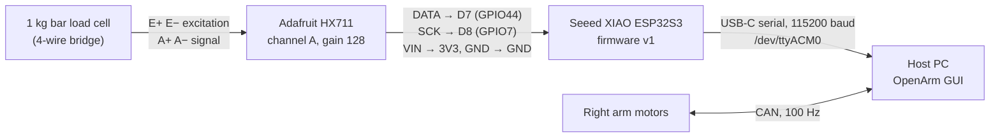

# Needle Load Cell: How It Is Connected and How the Recordings Were Made

This note covers the right arm's needle tool and the PLA and silicone recordings
taken on **2026-10-13**. The bench recordings from 2026-10-10/11 are covered
briefly in §8.

Related docs:
- [09_loadcell_force_feedback_plan.md](09_loadcell_force_feedback_plan.md): why the load cell was added
- [10_loadcell_force_feedback.md](10_loadcell_force_feedback.md): how to use the software

## 1. Summary

- **Mounting.** The gripper on the right arm has been replaced by a needle
  tool. A 1 kg bar load cell sits between a PLA bracket on the wrist flange
  and a PLA syringe clamp. All the force on the needle passes through the bar.
- **Wiring.** The load cell is read by an HX711 amplifier and a XIAO ESP32S3,
  which reaches the PC over USB. The arm reaches the same PC over CAN. The two
  are not linked in hardware; the GUI reads both.
- **Two files per trial.** Each trial saved two files:
  - a **load-cell CSV**: force in raw counts, about 89 samples per second
  - a **plunger log**: commanded and measured needle depth, joint angles and
    joint torques, 100 rows per second

  The two files use separate clocks. They are matched by their start times,
  to within about 1 s.
- **What was recorded on 2026-10-13.** 11 PLA trials and 15 silicone trials of
  load-cell data. 25 of the 26 have a matching plunger log.

## 2. Mechanical: how the load cell is mounted

The parts and their order come from the CAD (`new_setup&files/arm_with loadcell.step`).
They are listed in `src/tools/extract_needle_tool.py`:

```
right wrist flange (where the gripper used to be)
 └─ flange_bracket            PLA, bolted to the flange
     └─ load_cell             aluminium bar, 1 kg, strain gauges under epoxy covers
         └─ syringe_clamp     PLA, closed with a steel bolt
             └─ syringe       polypropylene barrel and plunger
                 └─ needle
```

- **Layout.** The bar sticks out sideways from the bracket, and the syringe
  clamp hangs from its free end. The syringe ends up about **93 mm to the side
  of the wrist axis**, parallel to it.
- **How it senses force.** The needle points along the tool's −X axis. When it
  pushes into a sample, the reaction travels up the syringe into the clamp and
  bends the bar. The strain gauges on the bar measure that bending. Because
  the cell is in series between the bracket and the syringe, it carries the
  full axial needle force.
- **Sign.** Pushing the needle in reads **positive** (`loadcell.sign: 1` in
  `config.yaml`). This was checked with hand presses on 2026-10-12.
- **Weight.** The tool weighs about 108 g (CAD estimate), against 422 g for
  the gripper. The arm model `sim_files/udrf/openarm_dual_needle.urdf` uses
  the tool's mass. It puts the tool point (TCP) at `openarm_right_needle_tip`.
- **Gripper motor.** Motor 0x08 is gone from the right arm.
  `motors.gripper.enabled.right: false` stops the code talking to it.
- **Bracket.** The first bracket broke during bench run 5 (§8), at about
  4.35 M counts. That's why the force graphs show a red abort line at 4.0 M
  counts (`guard.f_abort`).

## 3. Electrical: how it is wired



| From | To | Notes |
|---|---|---|
| Load cell E+, E−, A+, A− | HX711 E+, E−, A+, A− | Wire colours follow the cell's datasheet. They weren't recorded. |
| HX711 DATA | XIAO D7 (GPIO44) | |
| HX711 SCK | XIAO D8 (GPIO7) | |
| HX711 VIN | XIAO 3V3 | |
| HX711 GND | XIAO GND | |
| XIAO USB-C | Host PC USB | Shows up as `/dev/ttyACM0`. USB vendor ID 0x303A (Espressif), which `port: auto` looks for. |

**Firmware on the board: v1**, `new_setup&files/arm_loadcell/loadcell_raw/loadcell_raw.ino`.
- It reads HX711 channel A at gain 128. On this board that comes to about
  **89.5 samples per second**.
- It sends signed 24-bit raw counts. It does **no tare and no scaling**, so
  the logs can always be re-analysed.
- It accepts the commands `start`, `stop` and `status`. Each sample is sent as
  a line `<elapsed_ms>,<raw>`.
- A v2 firmware (`loadcell_stream.ino`) also exists. It adds a sequence number
  to every sample, but it hasn't been flashed yet.

**Host side.** `src/comm/loadcell.py` handles the board on the PC:
- It finds the port and tells which firmware is running.
- A background thread reads every sample and keeps the last 120 s.
- The GUI's force plot and the CSV recorder both read from that buffer.
- Serial access needs the user in the `dialout` group.

## 4. How the 2026-10-13 recordings were made

### Setup

| Item | Setting |
|---|---|
| Arm | Right arm, real hardware over CAN. kp 40 and kd 0.5 on every joint. Axis hold **off**. |
| Load cell | Firmware v1 on `/dev/ttyACM0`. Uncalibrated, so values are in counts. **Not tared**: `tare_offset` is 0 in every file, so `tared` equals `raw`. The untouched reading is about 23 k counts. |
| Motion | Plunger point 4 with **Guard off**: straight down at **2 mm/s** with a fixed path. The force had no effect on the motion. |
| Depth | 45 mm (22.5 s) for most trials. The first two PLA trials used 55 mm and 65 mm. |
| Start pose | Point 3, around (0.20, −0.08, 0.20) m in robot base coordinates, needle straight down. It varied by a few mm per trial, because each plunge starts from the measured pose. |
| Samples | A PLA block (the bone stand-in) and a silicone block, under point 3. |

### Steps for each trial (GUI, Plunger tab)

1. Start the GUI with `./run_gui.sh` and open the **Plunger** tab. In the
   *Load cell* row, leave the port on `auto` and click **Connect**. The force
   plot starts updating.
2. Run points 1–3 to bring the needle to its start pose above the block.
3. Tick **Record to CSV**. This starts a new file,
   `recordings/loadcell/<date>_<time>_loadcell.csv`, and writes every sample
   as it arrives (flushed every 200 ms).
4. Press **▶ 4 Plunge**. The needle goes straight down. Point 4 writes its own
   log, `recordings/plunger/<date>_<time>_right.csv`, one row per 10 ms
   control tick.
5. In 12 of the 14 silicone trials, **Mark (M)** was pressed once, 6.5–9.7 s
   into the descent. The Mark button is meant for flagging the moment the
   needle touches the sample. No marks were made in the PLA trials.
6. Recording continued for 5–20 s after the descent ended. Then *Record to
   CSV* was unticked, and **Save PNG…** saved the graph of the last 50 s next
   to the CSV (`<date>_<time>_force.png`).
7. Afterwards, the files were sorted by hand into `recordings/loadcell/PLA/`
   and `recordings/loadcell/sillicon/`.

### What each file holds

| File | Clock | Columns |
|---|---|---|
| `recordings/loadcell/<cond>/<stamp>_loadcell.csv` | `t_s` = seconds since *Record to CSV* was ticked (PC clock, when each sample arrived) | `t_s, seq, raw, tared, newtons, tare_offset, source` after 4 header lines. `newtons` is empty because the cell is uncalibrated. |
| `recordings/loadcell/<cond>/<stamp>_force.png` | Last 50 s before saving | The GUI force plot with the threshold lines: green contact 100 k, purple 1 M, orange 2.5 M, red abort 4 M |
| `recordings/plunger/<stamp>_right.csv` (`openarm-plunger v2`) | `t_s` = seconds since point 4 started | `t_s, mark, cmd_depth_mm, meas_depth_mm, joint1..7_deg, joint1..7_nm, tilt_deg, axis_hold_deg`. The header records point 3, depth, speed, gains and the Mark times. |

`meas_depth_mm` is the needle-tip depth along the line. It's computed from the
joint encoders through forward kinematics. `cmd_depth_mm` is where the
controller was told to be.

### Trial list

"Log start" is the plunger log's start time minus the load-cell CSV's start
time. Plunger `t_s = 0` therefore falls at about that value of load-cell
`t_s`. "Peak" is the maximum minus the untouched reading, in millions of
counts.

**PLA** (`recordings/loadcell/PLA/`)

| # | Load-cell CSV | Plunger log | Log start | Depth cmd | Peak (M counts) | Measured depth at end |
|---|---|---|---:|---:|---:|---:|
| 1 | `20261013_113254_loadcell.csv` | `20261013_113300_right.csv` | +6 s | 55 mm | 4.06 | 27.3 mm |
| 2 | `20261013_113650_loadcell.csv` | `20261013_113700_right.csv` | +10 s | 65 mm | 3.52 | 36.1 mm |
| 3 | `20261013_114356_loadcell.csv` | `20261013_114354_right.csv` | −2 s | 45 mm | 3.08 | 18.9 mm |
| 4 | `20261013_114518_loadcell.csv` | `20261013_114514_right.csv` | −4 s | 45 mm | 3.46 | 18.3 mm |
| 5 | `20261013_114637_loadcell.csv` | `20261013_114635_right.csv` | −2 s | 45 mm | 3.40 | 18.1 mm |
| 6 | `20261013_114758_loadcell.csv` | `20261013_114805_right.csv` | +7 s | 45 mm | 3.18 | 22.1 mm |
| 7 | `20261013_114922_loadcell.csv` | `20261013_114930_right.csv` | +8 s | 45 mm | 3.34 | 16.8 mm |
| 8 | `20261013_115120_loadcell.csv` | `20261013_115130_right.csv` | +10 s | 45 mm | 3.45 | 17.8 mm |
| 9 | `20261013_115240_loadcell.csv` | `20261013_115246_right.csv` | +6 s | 45 mm | 3.31 | 17.6 mm |
| 10 | `20261013_115408_loadcell.csv` | `20261013_115414_right.csv` | +6 s | 45 mm | 3.33 | 17.7 mm |
| 11 | `20261013_115536_loadcell.csv` | `20261013_115545_right.csv` | +9 s | 45 mm | 3.35 | 18.9 mm |

**Silicone** (`recordings/loadcell/sillicon/`). All silicone trials used a
45 mm commanded depth.

| # | Load-cell CSV | Plunger log | Log start | Peak (M counts) | Measured depth at end | Mark |
|---|---|---|---:|---:|---:|---:|
| 1 | `20261013_115911_loadcell.csv` | *none found* | – | 2.05 | – | – |
| 2 | `20261013_120057_loadcell.csv` | `20261013_120103_right.csv` | +6 s | 2.01 | 40.4 mm | 9.75 s |
| 3 | `20261013_120210_loadcell.csv` | `20261013_120216_right.csv` | +6 s | 2.01 | 31.4 mm | – |
| 4 | `20261013_120315_loadcell.csv` | `20261013_120321_right.csv` | +6 s | 2.28 | 34.8 mm | – |
| 5 | `20261013_120436_loadcell.csv` | `20261013_120433_right.csv` | −3 s | 2.10 | 34.1 mm | 6.80 s |
| 6 | `20261013_120542_loadcell.csv` | `20261013_120540_right.csv` | −2 s | 2.23 | 32.0 mm | 7.54 s |
| 7 | `20261013_120659_loadcell.csv` | `20261013_120656_right.csv` | −3 s | 2.04 | 32.6 mm | 7.69 s |
| 8 | `20261013_120809_loadcell.csv` | `20261013_120807_right.csv` | −2 s | 2.08 | 34.8 mm | 7.35 s |
| 9 | `20261013_121013_loadcell.csv` | `20261013_121019_right.csv` | +6 s | 2.15 | 31.8 mm | 6.51 s |
| 10 | `20261013_121228_loadcell.csv` | `20261013_121235_right.csv` | +7 s | 2.06 | 31.0 mm | 6.85 s |
| 11 | `20261013_121344_loadcell.csv` | `20261013_121351_right.csv` | +7 s | 2.22 | 35.0 mm | 6.75 s |
| 12 | `20261013_121526_loadcell.csv` | `20261013_121524_right.csv` | −2 s | 2.18 | 34.3 mm | 6.64 s |
| 13 | `20261013_121703_loadcell.csv` | `20261013_121711_right.csv` | +8 s | 2.33 | 32.7 mm | 7.07 s |
| 14 | `20261013_121822_loadcell.csv` | `20261013_121830_right.csv` | +8 s | 2.01 | 32.5 mm | 6.90 s |
| 15 | `20261013_121956_loadcell.csv` | `20261013_122003_right.csv` | +7 s | 2.19 | 33.0 mm | 6.68 s |

**Log start sign.** A negative log start means *Record to CSV* was ticked
2–4 s after the plunge began. The needle doesn't reach the block until 6–8 s
into the descent, so every recording still contains the contact.

Other plunger logs from that day (10:00–11:30, 11:34:51, 11:40:50, 12:29:46)
have no load-cell file.

## 5. Lining the two files up

The load-cell CSV and the plunger log run on separate clocks. Both record
their start time to the nearest second (`# created:` in the header).

To put force onto the plunger log's timeline:

```
load-cell t_s  ≈  plunger t_s  +  (plunger created − load-cell created)
```

The uncertainty is about ±1 s, which at 2 mm/s is about ±2 mm of depth.

**Check.** Take the force onset as the first sample 100 k counts above the
untouched reading. After alignment it falls **5.6–8.0 s** into the descent,
at commanded depths of **11–16 mm**. The Marks were pressed at 6.5–7.7 s (and
once at 9.7 s). They agree to within about 1.5 s, which is consistent with the
1-second rounding.

**For tighter alignment,** shift the load-cell data until either:
- the force onset lines up with the Mark, or
- the force onset lines up with the moment `meas_depth_mm` starts falling
  behind `cmd_depth_mm`.

## 6. Data quality

- **Rate.** Every file runs at 89.4–89.5 samples/s. The sample count over each
  file's span matches the board's rate, so no samples were lost overall.
  However, firmware v1 has no sequence number, so the `seq` column is only a
  PC-side counter and can't show a single lost sample. Firmware v2 fixes this.
- **Timestamps.** `t_s` is when a sample *reached the PC*, not when it was
  measured. USB delivers samples in bursts, so there are gaps of up to 145 ms
  followed by several samples at once. For a smooth time axis, use sample
  index ÷ 89.5 Hz.
- **No saturation.** The highest raw value was 4.08 M, against the HX711's
  limit of 8.39 M.
- **Uncalibrated.** All values are counts. As a rough guide only: if this is a
  typical 1 mV/V cell, 1 kg ≈ 2.15 M counts. The PLA peaks would then be about
  1.5 kg, above the cell's 1 kg rating. Run
  `python3 comm/loadcell.py calibrate` before quoting forces in newtons.
- **Not tared.** Subtract the untouched reading yourself: the median of the
  first second, about 23 k counts.

## 7. First look at the results

| | PLA, 45 mm trials (9) | Silicone, with a log (14) |
|---|---|---|
| Peak force above the untouched reading | 3.08–3.46 M counts | 2.01–2.33 M counts |
| Measured depth when the 45 mm command finished | 16.8–22.1 mm | 31.0–40.4 mm |
| Commanded minus measured depth at the end | 22.9–28.2 mm | 4.6–14.0 mm |

- **PLA.** The needle stopped advancing at about 17–19 mm, while the command
  carried on to 45 mm. The arm's joints behave like springs, so the growing
  gap between commanded and measured position is what kept pushing on the
  needle.
- **Separation.** In this set the two conditions don't overlap: the lowest
  PLA peak is 3.08 M and the highest silicone peak is 2.33 M. The 2026-10-10/11
  bench set did overlap (4.01 M silicone vs 4.35 M PLA). A threshold picked
  from these same trials still needs testing on new ones.

## 8. Earlier bench recordings (2026-10-10/11)

These came before the load cell was built into the GUI. They were made with
the standalone app `new_setup&files/arm_loadcell/recorder.py` (PySide6), using
the same board and firmware v1:

- **Files.** `new_setup&files/arm_loadcell/recordings/`, `experiment*_*.csv`
  and `exp0–5.png`. The CSV columns are `elapsed_ms,raw_value`, on the board's
  clock.
- **No arm data.** No depth or arm data was recorded alongside, so force
  could only be plotted against time.
- **The runs.** Experiment 0 was excluded. Experiments 1–3 are silicone,
  experiment 4 is PLA, and in experiment 5 the bracket broke.
- **Analysis.** `new_setup&files/arm_loadcell/analysis/experiment_analysis.md`.

The missing depth data is why the 2026-10-13 trials were recorded alongside
plunger logs.

## 9. Recommendations for the next session

1. **Use Guard: log** (`--guard log`) instead of Guard off. It moves the needle
   at constant speed just like today. It writes force, measured depth and
   commanded depth into **the same row of one log**, on one clock, so the
   alignment in §5 isn't needed. The safety trips still abort.
2. **Flash firmware v2** (`loadcell_stream.ino`) to get a real per-sample
   sequence number and the board's own timestamp.
3. **Tare** before each trial (*Tare* button), and **calibrate** once
   (`comm/loadcell.py calibrate`) so values come out in newtons.
4. **Name each trial.** Fill in the experiment name (for example `pla_01`, `sil_01`).
   It's added to both file names, which removes the hand sorting and the
   matching by time.
5. **Write down what the files don't capture:** needle gauge and length, block
   type and layering, and what each Mark meant.

## 10. Reading the files (Python)

```python
import numpy as np
from datetime import datetime

def read_log(path):
    """Header lines, data and start time of a load-cell CSV or a plunger log."""
    head = []
    with open(path) as f:
        for line in f:
            if not line.startswith("#"):
                break
            head.append(line.strip())
    data = np.genfromtxt(path, delimiter=",", names=True, skip_header=len(head),
                         dtype=None, encoding=None)
    created = next(l for l in head if l.startswith("# created:")).split(":", 1)[1].strip()
    return head, data, datetime.fromisoformat(created)

_, lc, lc_t0 = read_log("recordings/loadcell/sillicon/20261013_121344_loadcell.csv")
_, pl, pl_t0 = read_log("recordings/plunger/20261013_121351_right.csv")

offset = (pl_t0 - lc_t0).total_seconds()                       # +7 s for this pair
force = lc["raw"] - np.median(lc["raw"][lc["t_s"] < 1.0])      # counts above the untouched reading
force_on_plunger_clock = np.interp(pl["t_s"] + offset, lc["t_s"], force)
# now plot force_on_plunger_clock against pl["meas_depth_mm"] or pl["cmd_depth_mm"]
```

Run it from the `OpenArm_v4_GUI&ori/` folder with the project venv.
