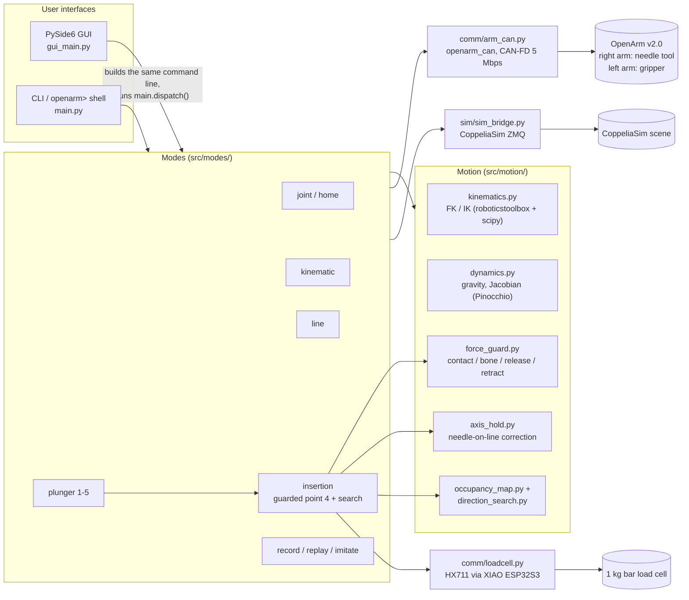
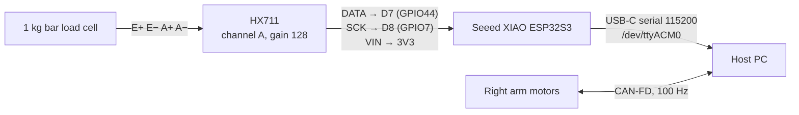
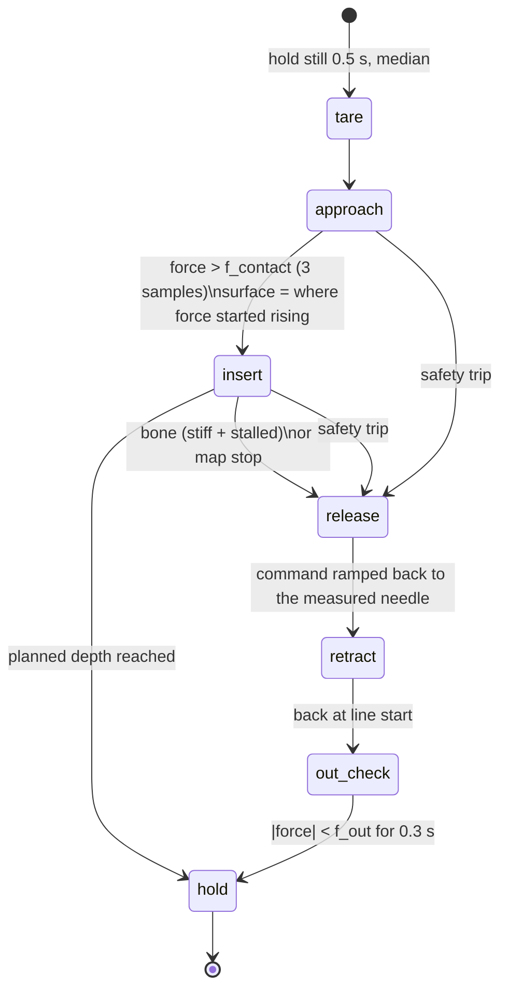

# Epidural Ninja

**Robot-assisted epidural needle insertion with force feedback and bone avoidance, on a dual-arm OpenArm v2.0.**

Epidural Ninja drives a 7-DOF OpenArm along a planned straight line with the needle held on its axis. A load cell in series with the syringe measures the axial needle force, and the controller uses it to:

1. detect skin/tissue contact,
2. tell bone (PLA phantom) apart from soft tissue (silicone phantom),
3. stop, take the stored push off the needle, and retract it along the same line, and
4. re-aim through the same entry point at a new angle while avoiding every bone hit it has seen before (stored in an occupancy map).

All of this runs from one CLI and shell (`main.py`) and a PySide6 desktop GUI, against CoppeliaSim, the real arm, or both at once. The packaged application is called **OpenArm Control** (version `4.1.0`, see [packaging/VERSION](packaging/VERSION)).

> [!WARNING]
> This is a research prototype on phantom tissue (silicone and PLA blocks). It is **not** a medical device and must never be used on a person or animal.

---

## Contents

- [Project status](#project-status)
- [How it works](#how-it-works)
- [Hardware](#hardware)
- [Repository layout](#repository-layout)
- [Installation](#installation)
- [Quick start](#quick-start)
- [The desktop GUI](#the-desktop-gui)
- [The CLI and interactive shell](#the-cli-and-interactive-shell)
- [The needle insertion workflow](#the-needle-insertion-workflow)
- [Configuration](#configuration)
- [Recordings and data formats](#recordings-and-data-formats)
- [Experimental results so far](#experimental-results-so-far)
- [Standalone plunger test rig](#standalone-plunger-test-rig)
- [Low-level and standalone tools](#low-level-and-standalone-tools)
- [Tests](#tests)
- [Safety](#safety)
- [Troubleshooting](#troubleshooting)
- [Known limitations and next steps](#known-limitations-and-next-steps)
- [Documentation index](#documentation-index)

---

## Project status

| Area | State |
|---|---|
| Joint, Cartesian (IK), line, record/replay and imitate control | Working on the real arm and in sim |
| Plunger experiment, points 1–4 (no force feedback) | Working on the real arm; 26 PLA/silicone trials recorded 2026-10-13 |
| Load-cell driver, force guard, bone-avoidance search, occupancy map, point 5 retract | Implemented and **tested in sim** with a fake load cell; the real load cell has been read through this code |
| Axis hold (keeps the needle on its line under load) | Implemented and checked against a spring-joint model; **not yet run on the real arm** |
| Needle-tool URDF (`openarm_dual_needle.urdf`) | Built from the CAD; needle length still `0` until measured |
| Bone-detection thresholds (`f_bone_min`, `k_bone`, `f_soft`) | **Provisional.** Tuned on the fake phantom only, so use `--guard log` on the real arm until they are fitted to real data |
| Unit tests | 41 passing (`src/tests/`) |
| Packaging | In-place install, single-file `.run` installer, and `.deb` package |

---

## How it works



**Core ideas:**

- **Every move is planned before anything moves.** Lines and plunges are solved with IK knot by knot (2 mm spacing by default), each seeded from the previous one so the arm stays on one continuous configuration. If any knot is unreachable, nothing moves.
- **The tool axis is held on the line.** For `line --orient path` and the plunger, the needle axis (the TCP's −X axis) is constrained parallel to the direction of travel. That is 5 constraints on a 7-DOF arm, which leaves 2 redundant DOF to fit the arm's narrow real joint limits.
- **Streaming is scheduled by wall-clock time** at 100 Hz, with minimum-jerk ramps. A late tick jumps to where the path should be now instead of bursting through missed waypoints.
- **The motors are MIT-mode PD springs** (kp 40 Nm/rad by default) with optional Pinocchio gravity feedforward per joint. Because the joints are compliant, the command runs ahead of the real needle under load. The force guard uses that: it ramps the command back before retracting, so the stored push comes off the needle.
- **The force guard sets path speed, not position.** Every tick it returns a *rate*: `1` = planned speed, `0` = hold, negative = run the same knots backwards. Retracting therefore follows exactly the insertion line.
- **`--mode both` runs closed-loop.** The real arm is commanded, its *measured* joint angles are read back, and those are written into the sim. The sim shows what the arm really did, not an idealised copy.
- **One worker thread owns all hardware.** `openarm_can` is not thread-safe, so in the GUI every CAN call goes through a single worker. Sim mirroring runs on its own thread so a ZMQ stall never delays a CAN frame.

---

## Hardware

### Robot and CAN bus

| Component | Details |
|---|---|
| Robot | OpenArm v2.0, dual arm (7 DOF each) |
| CAN adapter | SAVVYCANFD 2-channel CAN-FD USB: `can0` = **right** arm, `can1` = **left** arm |
| Bus | CAN-FD, 1 Mbps arbitration / 5 Mbps data |
| Motors per arm | joint1–2 Damiao **DM8009** (±54 Nm), joint3–4 **DM4340** (±28 Nm), joint5–7 **DM4310** (±10 Nm) |
| Gripper | DM4310 on the **left** arm only. The right arm's gripper motor was removed for the needle tool (`motors.gripper.enabled.right: false`) |
| Motor IDs | send `0x01`–`0x08`, receive `0x11`–`0x18` (same on both arms) |
| Driver library | `openarm_can` 1.2.8 (system package `python3-openarm-can`, C++ with nanobind bindings) |

> [!IMPORTANT]
> The motor types in `config.yaml` (`motors.arm.types`) **must match the real motors**. `openarm_can` scales `tau_ff`, torque and velocity using the *declared* type's range. Declaring a DM4340 as a DM4310 multiplies its gravity feedforward by 2.8×. Check with `python3 comm/arm_can.py params --arm right`.

Real joint limits differ per side and are **not** mirror images. They live in `config.yaml` under `R_right_arm` / `R_left_arm` and can be edited live in the GUI (Settings tab).

### Needle tool (right arm)

The gripper on the right arm is replaced by a 3D-printed needle tool. CAD: `new_setup&files/arm_with loadcell.step`.

```text
right wrist flange
 └─ flange_bracket       PLA, bolted to the flange
     └─ load_cell        1 kg aluminium bar, strain gauges
         └─ syringe_clamp  PLA
             └─ syringe
                 └─ needle  (points along the tool's −X axis)
```

- The syringe sits about **93 mm to the side of the wrist axis**, parallel to it. That offset is why insertion force twists the wrist, and why the axis hold exists.
- The tool weighs about **108 g** (CAD estimate), compared with 422 g for the gripper. The URDF `sim_files/udrf/openarm_dual_needle.urdf` models it, with the TCP at `openarm_right_needle_tip`.
- The first bracket **broke at about 4.35 M counts**. `guard.f_abort` is set to 4.0 M to stay below that.

### Load cell electronics



| Firmware | Sketch | Notes |
|---|---|---|
| v1 (currently flashed) | `new_setup&files/arm_loadcell/loadcell_raw/loadcell_raw.ino` | About 89.5 Hz, raw signed 24-bit counts, lines `<ms>,<raw>`, commands `start`/`stop`/`status` |
| v2 (recommended) | `new_setup&files/arm_loadcell/loadcell_stream/loadcell_stream.ino` | Adds a per-sample sequence number (exact dropped-sample count) and reports a dead HX711 within 200 ms |

The host driver auto-detects which firmware is running. With `port: auto`, it picks the Espressif USB device (VID `0x303A`). Pushing the needle *in* reads **positive**.

---

## Repository layout

```text
Epidural_Ninja/
├── run_gui.sh                 Start the GUI with the project venv
├── src/
│   ├── main.py                CLI + interactive openarm> shell + dispatch
│   ├── gui_main.py            GUI entry point (splash → gui.app.run)
│   ├── _bootstrap.py          Puts src/ sub-directories on sys.path
│   ├── session.py             Per-side real/sim connection cache
│   ├── streaming.py           Per-tick senders + threaded sim mirror
│   ├── recording.py           Record/replay file format, trimming, speed checks
│   ├── config/
│   │   ├── config.yaml        All defaults (never written by the GUI)
│   │   ├── user_config.yaml   GUI-edited overrides (gains, limits, layout...)
│   │   └── config.py          Loader; overlays user_config on config.yaml
│   ├── comm/
│   │   ├── arm_can.py         Real arm over CAN-FD (ArmController + CLI)
│   │   └── loadcell.py        HX711 serial driver, fake load cell, calibration CLI
│   ├── motion/
│   │   ├── kinematics.py      FK / IK / axis-constrained IK (ArmKinematics + CLI)
│   │   ├── dynamics.py        Pinocchio gravity torque, Jacobian, J^T F
│   │   ├── trajectory.py      Minimum-jerk profiles
│   │   ├── motion.py          Real-arm ramps, target validation, waypoint clamping
│   │   ├── force_guard.py     The insertion state machine (pure logic)
│   │   ├── axis_hold.py       Integrating needle tilt/offset correction
│   │   ├── occupancy_map.py   Bone-hit map (spheres), line/sphere queries
│   │   └── direction_search.py Candidate tilts ranked by map clearance
│   ├── modes/
│   │   ├── mode_joint.py      joint, home
│   │   ├── mode_kinematic.py  kinematic
│   │   ├── mode_line.py       line (planner + executor)
│   │   ├── mode_plunger.py    plunger points 1–5
│   │   ├── insertion.py       Guarded point 4 + bone-avoidance search
│   │   ├── mode_imitate.py    imitate
│   │   ├── mode_record.py     record
│   │   └── mode_replay.py     replay
│   ├── sim/
│   │   ├── sim_bridge.py      CoppeliaSim read/write (SimArmController + CLI)
│   │   └── sim_force_control.py  Sim force-control test rig (J^T F)
│   ├── gui/                   app, tabs, widgets, plots, backend worker, kin preview
│   ├── tools/                 extract_needle_tool.py, make_needle_urdf.py
│   ├── test_scripts/          replay_force_guard.py (offline guard tuning), dynamic_test.py
│   └── tests/                 pytest suite
├── sim_files/
│   ├── dual_openarm_org.ttt        CoppeliaSim scene (~90 MB)
│   ├── dual_openarm_switched.ttt   Alternative scene
│   └── udrf/                       openarm_dual.urdf, openarm_dual_needle.urdf, meshes, needle_tool/
├── recordings/
│   ├── plunger/               Plunger point 4 logs (joint angles, torques, depth)
│   ├── loadcell/PLA|sillicon/ Load-cell CSVs + force PNGs, 2026-10-13
│   ├── line_torque/           Torque logs from `line` on the real arm
│   ├── search/                Search runs: attempt_NN.csv, summary.csv, map.json
│   └── maps/                  Occupancy maps
├── plunger/                   Standalone bench plunger rig (Arduino UNO R4 + Tk GUI)
├── new_setup&files/           Load-cell bench app, firmware, analysis, CAD STEP
├── packaging/                 install.sh, build_installer.sh, build_deb.sh, icons, requirements
└── docs/                      Detailed design notes and user guides (01–12)
```

Every module imports its siblings by bare name (`from arm_can import ...`) through `_bootstrap.py`. Sub-directory scripts therefore run directly as `python3 comm/arm_can.py ...` from `src/`.

---

## Installation

### Requirements

- **Ubuntu 22.04** with **Python 3.10** (the tested combination; other versions use the loose requirements)
- For the real arm: the OpenArm PPA package `python3-openarm-can`, plus `can-utils`
- For simulation: [CoppeliaSim](https://www.coppeliarobotics.com/) 4.x with the ZMQ Remote API (enabled by default)
- For the load cell: serial access (membership of the `dialout` group)
- Qt on X11 needs `libxcb-cursor0`

Python libraries ([packaging/requirements.txt](packaging/requirements.txt), pinned):

| Library | Used for |
|---|---|
| `numpy`, `scipy` | Math; `scipy.optimize.least_squares` is the IK solver |
| `roboticstoolbox-python`, `spatialmath-python` | URDF kinematic chains, SE3 poses |
| `pin` (Pinocchio) | Gravity torque, Jacobians |
| `PySide6`, `matplotlib` | GUI and plots |
| `coppeliasim-zmqremoteapi-client`, `pyzmq` | CoppeliaSim |
| `PyYAML` | Config |
| `pyserial` | Load cell |
| `pytest` | Tests |

`openarm_can` is **not** a pip package. It's a system apt package, and `config.yaml → paths.openarm_can` points at `/usr/lib/python3/dist-packages` so the venv can import it.

### Development setup

```bash
git clone <this repo> Epidural_Ninja
cd Epidural_Ninja

# Python environment (run_gui.sh looks for .venv here, or one folder up)
python3 -m venv .venv
.venv/bin/pip install -r packaging/requirements.txt \
  || .venv/bin/pip install -r packaging/requirements-loose.txt

# System packages
sudo apt install libxcb-cursor0 can-utils
sudo add-apt-repository ppa:openarm/main && sudo apt install python3-openarm-can   # real arm only

# Serial access for the load cell (log out and back in afterwards)
sudo usermod -aG dialout $USER
```

### Bring up the CAN interfaces (every boot)

SocketCAN interfaces come up `DOWN` after every reboot, unplug, or sleep. Nothing in this project brings them up automatically.

```bash
for i in can0 can1; do
  sudo ip link set $i down
  sudo ip link set $i type can bitrate 1000000 dbitrate 5000000 fd on
  sudo ip link set $i up
done
ip link show can0; ip link show can1      # both should say "state UP"
```

If a process was started while the interface was down, restart that process after bringing the interface up. It is holding a dead handle.

### Packaged installs (OpenArm Control)

Every option below adds an app-menu entry plus two commands: `openarm-gui` (the GUI) and `openarm` (the shell, or a one-shot command).

| Method | Command | Installs to |
|---|---|---|
| In place (this checkout) | `bash packaging/install.sh --in-place` | Menu entry + launchers that run this folder with its existing `.venv` |
| Single user, other PC | `bash packaging/build_installer.sh [--offline]` → copy and run `OpenArm-Control-4.1.0-installer.run` | `~/OpenArm-Control` (own venv, recordings kept on upgrade) |
| All users, other PC | `bash packaging/build_deb.sh [--offline]` → `sudo apt install ./openarm-control_4.1.0_all.deb` | `/opt/openarm-control`; per-user data in `~/OpenArm` (`OPENARM_DATA_DIR`) |

Build outputs go to `packaging/dist/`, which is git-ignored because the files exceed GitHub's 100 MB limit. CoppeliaSim and CAN bring-up are not part of any installer. Full details: [docs/11_installing.md](docs/11_installing.md).

---

## Quick start

### 1. Simulation only (no hardware)

1. Start CoppeliaSim and open `sim_files/dual_openarm_org.ttt` (or use **Connections → Load scene** in the GUI).
2. Start the GUI:
   ```bash
   ./run_gui.sh
   ```
3. Or use the shell:
   ```bash
   cd src
   ../.venv/bin/python main.py
   openarm> home --arm both
   openarm> kinematic --pose 0.3 -0.3 0.25
   openarm> line --start 0.302 -0.346 0.28 --angles 0 0 --depth 0.04
   ```
4. A guarded needle insertion with the fake load cell and a simulated bone sphere:
   ```bash
   openarm> plunger --point 1 --deg 0 30 0 60 0 0 0
   openarm> plunger --point 2
   openarm> plunger --point 3 --xyz 0.2 -0.095 0.26 --depth 0.06
   openarm> plunger --point 4 --xyz 0.2 -0.095 0.26 --depth 0.06 --guard on --search --map simtest --map-new
   ```

`--mode` defaults to `sim` for every command, so **nothing touches the real arm unless you ask for it.**

### 2. Real arm

1. Bring up `can0` / `can1` (above).
2. Sanity check: `python3 comm/arm_can.py status --arm right` (from `src/`).
3. Plug in the load cell and check it: `python3 comm/loadcell.py noise --seconds 10`.
4. In the GUI, set **Drive = real** or **both** (the toolbar turns red: *REAL HARDWARE*), **Enable** the arm, then **Hold pose**.
5. Run the plunger points from the **Plunger** tab, starting with **Guard: log**.

---

## The desktop GUI

```bash
./run_gui.sh          # or: cd src && ../.venv/bin/python gui_main.py
```

The GUI does not reimplement any motion. Each button builds the command line the CLI would take, parses it with `main.py`'s parser, and runs it through `main.dispatch()`. The console prints the equivalent `openarm>` command before its output, so anything done in the GUI can be repeated in the shell.

| Area | Contents |
|---|---|
| **Toolbar** | Arm (left/right/both), Drive (sim/real/both; turns red when real is included), **STOP** (Esc), **Disable all motors** |
| **Connections** | Per-arm Enable/Disable and status; Hold pose, Go limp, Print state; per-joint **gravity feedforward** switches with live τ_g values; CoppeliaSim start/pause/stop, load scene, list joints |
| **Tabs** | Joint · Cartesian · Line · Plunger · Imitate · Record · Replay · Scope · Settings |
| **Live view** | 3D stick figures (real solid, sim dashed), the active tab's overlay (targets, IK ghost, line path, plunge points, map hits), and a joint table with angles, torques and EE position |
| **Console** | Colour-coded output, plus an input line that accepts the same commands as the shell |

The **Plunger** tab holds the whole needle experiment: points 1–5, guard mode and thresholds (applied the moment they change, even mid-run), load-cell connect/tare/live force plot with threshold lines, **Record to CSV**, **Save graph PNG**, the occupancy-map top and side views, and the **Mark (M)** button for flagging the moment of contact.

Settings persist in `src/config/user_config.yaml` (gains, gravity switches, joint limits, sim endpoint, window layout, tab inputs). `config.yaml` is never written by the GUI. Full guide: [docs/08_gui.md](docs/08_gui.md).

---

## The CLI and interactive shell

Run from `src/`. With no arguments you get the persistent `openarm>` shell: connections stay open between commands, history is saved to `~/.openarm_shell_history`, and Ctrl+C interrupts the running command without leaving the shell. With arguments it runs one command and exits, disabling the motors.

| Mode | What it does | `--mode` |
|---|---|---|
| `joint` | Joint angles in degrees, minimum-jerk ramp | sim / real / both |
| `home` | `joint --deg 0 0 0 0 0 0 0` | sim / real / both |
| `kinematic` | EE pose → IK (seeded from the current pose) → drive | sim / real / both |
| `line` | EE along a straight line in 3 speed-staged sections, tool held on the line | sim / real / both |
| `plunger` | Needle experiment, one point per command (1–5); guarded insertion + search | sim / real / both |
| `imitate` | Real arm made limp, sim mirrors it | real → sim |
| `record` | Move the real arm by hand, save the motion | real / both |
| `replay` | Play a recording back (speed-checked) | sim / real / both |

Common flags: `--arm {left,right,both}` (default `right`), `--mode {sim,real,both}` (default `sim`), `--kp`/`--kd` (real arm only), `--sim-host`/`--sim-port`, `--dry-run` (plan only, for `line` and plunger points 3–4).

```bash
python3 main.py joint --arm left --mode real --deg 0 -30 0 60 0 0 0 --duration 3
python3 main.py kinematic --pose 0.302 -0.346 0.241 --mode sim      # preview first...
python3 main.py kinematic --pose 0.302 -0.346 0.241 --mode both     # ...then drive real + mirror
python3 main.py line --start 0.30 -0.35 0.30 --angles 15 90 --depth 0.06 --speeds 0.05 0.01 0.004 --split 0.7
python3 main.py record --name demo --mode both
python3 main.py replay --name demo --mode real --speed 0.5
```

**Line direction convention:** `--angles TILT ROT` gives `dir = (sin(tilt)·cos(rot), sin(tilt)·sin(rot), −cos(tilt))`. So `0 0` is straight down and `15 90` is tilted 15° toward +Y. All poses are in the shared `robot_base` frame.

Every flag, output example and design note is in [docs/07_main_script.md](docs/07_main_script.md).

---

## The needle insertion workflow

### Plunger points

| Point | What moves | Key inputs |
|---|---|---|
| **1** Safe pose | Joints 1→7 one at a time, each finishing before the next | `--deg D1..D7` |
| **2** Joint 3 → 0 | Joint 3 only | — |
| **3** Plunge start | One joint-space move to `--xyz` with the needle pointing straight down; the configuration is chosen so the whole descent plans continuously | `--xyz X Y Z`, `--depth` |
| **4** Plunge | Straight down `--depth` at `--speed`, needle held vertical, every tick logged. Runs point 3 first if the arm isn't there | `--depth`, `--speed`, `--guard`, `--search` |
| **5** Retract out | Backs the needle out along the last insertion line | — |

Points 3 and 4 plan from the arm's **measured** pose (encoders), not the held setpoint. The difference is carried into the descent as a preload, so the first command produces no jump. After any point 4, points 3 and 4 refuse to move until point 5 has backed the needle out. This stops a joint-space move from dragging the needle sideways through the block.

### Force guard (`--guard off | log | on`)

| `--guard` | Behaviour |
|---|---|
| `off` (default) | Constant-speed plunge, no load cell |
| `log` | Constant speed whatever the force. Contact, bone and map events are only *noted* (`would_*`), but **safety trips still abort, release and retract**. Use this for data collection |
| `on` | Full state machine below |



- **Contact:** force above `f_contact` (100 k counts, about 5 sd of the worst baseline noise) for 3 samples.
- **Insert:** speed drops linearly from `insert_speed` toward `s_min` × speed as force rises from `f_contact` to `f_soft`.
- **Bone:** force ≥ `f_bone_min`, *and* stiffness (force per mm of **measured** travel over `stiff_window_mm`) ≥ `k_bone`, *and* the needle stalling (measured advance < 25 % of commanded), sustained for `t_persist_s`. Peak force alone does **not** separate bone from silicone in the data, so stiffness and stall carry the decision.
- **Safety trips (always active, even in `log`):** `f_abort` (4 M counts, below the bracket failure), pull-out force, stale load cell (> 100 ms), dropped samples, HX711 saturation, command-vs-measured lag > 20 mm.
- **Release:** the compliant arm's command runs ahead of the needle, and that lag is what pushes it. Before retracting, the command is ramped back to the measured position so the needle isn't left loaded.
- **Tare:** before every attempt. The run refuses to start if the tare is noisy (`tare_noise_max`) or moved too far since the last one (`tare_jump_max`, which suggests the needle is still touching something).

### Bone-avoidance search (`--search`)

1. **Attempt 1** goes straight down. Its contact defines the **entry point E** on the surface.
2. After a bone hit or map stop, **with the needle confirmed out**, candidate directions are generated: tilts of 5/10/15/20° every 45° about the vertical.
3. Any line passing within `hit_radius + line_margin` of a known hit is blocked. The rest are ranked by smallest tilt, then most clearance, then furthest from all hits.
4. The arm **re-aims** with a guarded joint-space move to a point `h_safe` (15 mm) above E on the new line. The move is checked to keep the tip ≥ `h_min` (5 mm) above the surface; if it doesn't, the start is raised in 10 mm steps up to 45 mm. Any force during the move reverses it. Then it re-tares and inserts.
5. The search ends at target depth, at `max_attempts` (6), when no reachable unblocked direction is left, or on any safety trip. **A safety trip never triggers an automatic retry.**

### Occupancy map

Stored as `recordings/maps/<name>.json`, one per phantom setup, in `robot_base` coordinates. Each bone hit is a sphere of `hit_radius_mm` (3 mm) at the needle tip where bone was decided. On every tick, if the **commanded** tip comes within `map_stop_mm` (2 mm) of a hit sphere, the needle stops, so a known bone is never touched again, even in a later session. Use `--map-new` (or **Clear now…** in the GUI) whenever the block moves; the old file is kept with a timestamp. A contact more than 3 mm from the stored E prints a "block moved?" warning.

### Axis hold

**Measured problem (2026-10-13):** the IK plan held the needle exactly vertical, but under insertion load the real needle tilted **2.3–4.4°** and its tip drifted **16–27 mm** off the line. The joints are PD springs and the needle is 93 mm off the wrist axis, so the force twists the wrist.

**Fix:** `motion/axis_hold.py` (on by default on the real arm). Every tick it measures needle tilt and sideways tip offset by FK and adds a slowly integrating joint correction. Motion **along** the needle is left soft, because the guard relies on it. The correction is capped at 8° per joint and 5°/s and kept within joint limits. On a spring-joint model that reproduces the real runs, it cuts a 2.5° / 17 mm error to 0.25° / 1.7 mm. Disable with `--no-axis-hold` or the GUI checkbox.

### Examples

```bash
# Real arm, real load cell, data collection
python3 main.py plunger --point 4 --xyz 0.2 -0.095 0.26 --depth 0.06 --mode real --guard log --name pla_01

# Real arm, full guard + search
python3 main.py plunger --point 4 --xyz 0.2 -0.095 0.26 --depth 0.06 --mode real --guard on --search --map block_A

# Retract after a run that held at depth
python3 main.py plunger --point 5 --mode real
```

Additional point 4 flags: `--loadcell real|fake`, `--fake-phantom sphere|slab|none`, `--insert-speed`, `--on-bone retract|hold`, `--on-success hold|retract`, `--f-contact`, `--f-abort`, `--map-skip-blocked`, `--max-attempts`, `--max-tilt`.

Full guide: [docs/10_loadcell_force_feedback.md](docs/10_loadcell_force_feedback.md). Design rationale: [docs/09_loadcell_force_feedback_plan.md](docs/09_loadcell_force_feedback_plan.md).

---

## Configuration

All defaults are in [src/config/config.yaml](src/config/config.yaml). At start-up, `config.py` overlays `user_config.yaml` (written by the GUI when it closes) on top.

| Section | Contents |
|---|---|
| `paths` | URDF (`openarm_dual_needle.urdf` by default), sim scenes, recordings folder, `openarm_can` location |
| `can` | Interface per side, CAN-FD bitrates |
| `motors` | Motor types (**must match the hardware**), CAN IDs, gripper enable per side |
| `control` | `kp`/`kd` per joint (default 40 / 0.5), `ctrl_hz` (100), `joint_tauG_enable` gravity-feedforward mask |
| `sim` | CoppeliaSim host/port (`localhost:23000`) |
| `R_right_arm`, `R_left_arm` | Real joint limits (degrees) and gripper open/close angles, per side |
| `tool` | Extra TCP offset on top of the URDF needle tip |
| `loadcell` | Port (`auto`), baud, sign, `scale_counts_per_n` (null = uncalibrated, use counts), fake phantom definitions |
| `guard` | All force-guard thresholds, speeds and timings (in `units`: counts until calibrated) |
| `search` | Tilt steps, rotation step, max tilt/attempts, safe heights |
| `map` | Map folder/name, hit radius, line margin, map-stop distance |
| `axis_hold` | `enabled`, integral gain, max correction, max rate |

The GUI writes only what it edits (gains, gravity switches, joint limits, sim endpoint, window state) to `user_config.yaml`. Guard, load-cell, search and map settings belong to `config.yaml`. If `user_config.yaml` still overrides any of them, a note appears at start-up. To discard GUI state, use **Settings → Reset to config.yaml** and restart.

---

## Recordings and data formats

All logs are CSV with `#` metadata header lines. Read them with `pandas.read_csv(path, comment="#")`, or with `np.genfromtxt(path, delimiter=",", names=True, skip_header=N)`.

| Folder | Written by | Columns (abridged) |
|---|---|---|
| `recordings/<name>.csv` | `record` | `t_s`, `{side}_joint1_deg … joint7_deg` |
| `recordings/line_torque/` | `line` on the real arm | `t_s, section, cmd_depth_mm, joint*_deg, joint*_nm` |
| `recordings/plunger/` (v2, guard off) | Plunger point 4 | `t_s, mark, cmd_depth_mm, meas_depth_mm, joint*_deg, joint*_nm, tilt_deg, axis_hold_deg` |
| `recordings/plunger/` (v3, guarded) | Guarded point 4 | `t_s, mark, state, rate, cmd_depth_mm, meas_depth_mm, lag_mm, force_raw, force, force_age_ms, force_seq, joint*_deg, joint*_nm` (+ tilt/axis hold) |
| `recordings/search/<stamp>_<side>[_name]/` | `--search` | `attempt_NN.csv` (v3), `summary.csv`, `map.json` |
| `recordings/maps/<name>.json` | Occupancy map | Hits, entry point, attempt lines |
| `recordings/loadcell/` | GUI **Record to CSV** | `t_s, seq, raw, tared, newtons, tare_offset, source` |

- `meas_depth_mm` is the needle-tip depth computed from joint encoders by FK; `cmd_depth_mm` is where the controller was told to be. The gap between them is the compliance lag.
- Joint torques are the motors' reported total torque, so they include gravity load. Sim runs have no torques.
- `mark` holds the Mark number on the first row at or after each GUI Mark press.
- Guarded logs put force and depth in the **same row on one clock**. Unguarded runs plus a separate load-cell CSV have to be aligned by their `# created:` timestamps (about ±1 s); see [docs/12](docs/12_loadcell_setup_and_recordings.md#5-lining-the-two-files-up).

For offline tuning of the bone rule against recorded logs:

```bash
python3 test_scripts/replay_force_guard.py ../recordings/plunger/*_pla_*.csv --plot
python3 test_scripts/replay_force_guard.py <silicone logs> --k-bone 8e5 --f-bone-min 1.5e6
```

---

## Experimental results so far

### 2026-10-13: real arm, needle tool, guard off

Point 4 at 2 mm/s, mostly 45 mm commanded depth, kp 40, axis hold off, load cell uncalibrated and not tared. 11 PLA and 15 silicone trials (`recordings/loadcell/PLA/`, `recordings/loadcell/sillicon/`, matching logs in `recordings/plunger/`).

| | PLA (bone stand-in), 9 trials at 45 mm | Silicone, 14 trials with a log |
|---|---|---|
| Peak force above the untouched reading | **3.08–3.46 M** counts | **2.01–2.33 M** counts |
| Measured depth when the 45 mm command ended | 16.8–22.1 mm | 31.0–40.4 mm |
| Commanded minus measured at the end | 22.9–28.2 mm | 4.6–14.0 mm |

- In PLA the needle stops advancing at about 17–19 mm while the command continues. The growing lag is what keeps loading the needle, which is exactly the "stiff + stalled" signature the bone rule looks for.
- In this set the two conditions **do not overlap** in peak force. The earlier bench set (2026-10-10/11) did overlap (4.01 M silicone vs 4.35 M PLA), so a threshold fitted here still needs testing on new trials.
- Force onset falls 5.6–8.0 s into the descent (11–16 mm commanded), which agrees with the operator's Mark presses to within about 1.5 s.

### Why a load cell instead of motor torque

The original idea was to detect bone from joint motor torques. The 2026-10-06 plunger runs showed this doesn't work: even with the needle 15–24 mm behind its command, joint 2's torque only varied between −1.15 and −0.99 Nm, which is lost in gravity load and friction. The load cell measures axial force directly, with loads in the millions of counts against 10–25 k noise.

### 2026-10-10/11: bench load-cell runs

Recorded with the standalone app `new_setup&files/arm_loadcell/recorder.py` (force vs time only, no depth). Analysis: [new_setup&files/arm_loadcell/analysis/experiment_analysis.md](new_setup&files/arm_loadcell/analysis/experiment_analysis.md). The bracket broke in run 5 at about 4.35 M counts.

Full write-up of setup, trial list, alignment and data quality: [docs/12_loadcell_setup_and_recordings.md](docs/12_loadcell_setup_and_recordings.md).

---

## Standalone plunger test rig

`plunger/` is a separate bench rig for characterising needle insertion without the arm: a stepper-driven linear plunger with a load cell and a laser distance sensor.

| Part | Connection |
|---|---|
| Arduino UNO R4 (Minima / WiFi) | USB serial, 115200 baud |
| HX711 + load cell | DATA D6, SCK D5 |
| PCA9548A I²C mux (0x70) | CH0: VL53L1X laser distance, CH1: MPU6500 IMU |
| TMC2209 stepper driver | STEP D10, DIR D11 |

- **Firmware:** [plunger/arduino/uno_r4_sensors/uno_r4_sensors.ino](plunger/arduino/uno_r4_sensors/uno_r4_sensors.ino). It needs the *Adafruit HX711* and *VL53L1X by Pololu* libraries. It accepts `F` / `R` / `S` (forward / reverse / stop) and stops the motor by itself 350 ms after the last command.
- **GUI:** `python3 plunger/gui/plunger_gui.py` (Tkinter + matplotlib + pyserial). Arrow keys jog the motor (the command repeats every 100 ms while held). **Plunge** / **Reset** drive until the laser reads a target distance, with timeout, lost-laser and wrong-direction safety stops. Live plots show HX711 raw counts and distance. **Record CSV…** logs `pc_time, ms, hx711_raw, distance_mm, range_status, motor`.
- **Data (2026-10-15):** `plunger/gui/out/sillicon/` (13 runs) and `plunger/gui/out/hole/` (12 runs).

---

## Low-level and standalone tools

Run from `src/`. Each tool is also importable as a library.

```bash
# Real arm over CAN (subcommand first, then --arm)
python3 comm/arm_can.py status --arm right
python3 comm/arm_can.py params --arm right          # motor PMAX/VMAX/TMAX registers vs config types
python3 comm/arm_can.py read --arm right --rate 20  # backdrivable live monitor
python3 comm/arm_can.py move --arm right --deg 0 30 0 60 0 0 0 --duration 2

# Kinematics
python3 motion/kinematics.py --arm right --fk 0 30 0 60 0 0 0
python3 motion/kinematics.py --arm right --ik 0.3 -0.3 0.25          # position only

# Dynamics (Pinocchio)
python3 motion/dynamics.py --arm right --gravity 0 30 0 45 0 20 0

# CoppeliaSim
python3 sim/sim_bridge.py list                      # every joint alias in the scene
python3 sim/sim_bridge.py move --arm left --deg 0 -30 0 60 0 0 0
python3 sim/sim_force_control.py test --arm left --force 0 0 2 --gravity-comp --sensor openarm_force_test_sensor

# Load cell
python3 comm/loadcell.py ports
python3 comm/loadcell.py monitor
python3 comm/loadcell.py noise --seconds 10
python3 comm/loadcell.py calibrate --masses 0 50 100 200 500 [--load hang] [--save]
python3 comm/loadcell.py fake --phantom sphere

# Needle-tool URDF from the CAD (re-run with measured values)
python3 tools/make_needle_urdf.py --needle-mm <tip below nozzle> --tool-mass-g <weighed> [--fluid-ml <ml>]
```

`--arm` must come **after** the subcommand. This works around an argparse quirk where subparser defaults overwrite a top-level option; see [docs/02](docs/02_arm_can_script.md#why---arm-goes-after-the-subcommand).

Per-script deep dives: [arm_can](docs/02_arm_can_script.md) · [kinematics](docs/03_kinematics_script.md) · [sim_bridge](docs/04_sim_bridge_script.md) · [Pinocchio](docs/05_pinocchio_integration.md) · [sim force control](docs/06_ee_force_control.md).

---

## Tests

```bash
cd src
PYTEST_DISABLE_PLUGIN_AUTOLOAD=1 ../.venv/bin/python -m pytest tests -q
# 41 passed
```

`PYTEST_DISABLE_PLUGIN_AUTOLOAD=1` stops a ROS 2 pytest plugin, if one is installed system-wide, from breaking start-up. The suite needs no hardware and no CoppeliaSim.

| File | Covers |
|---|---|
| `test_force_guard.py` | Contact, insert slow-down, bone rule, stall, safety trips, release/retract, out-check, log mode |
| `test_loadcell.py` | Firmware v1/v2 parsing, sequence/drop counting, tare, fake load cell |
| `test_map_and_search.py` | Occupancy-map geometry, map stop, direction ranking |
| `test_axis_hold.py` | Tilt/offset correction, limits, rate caps |
| `test_point4_measured_start.py` | Point 4 planning from the measured pose with preload |
| `test_userconfig.py` | What the GUI writes to `user_config.yaml` |

---

## Safety

- **Default is sim.** Every command defaults to `--mode sim`. In the GUI, real hardware turns the toolbar red, and **Settings → Ask before every command that drives the real arm** adds a confirmation.
- **Targets are strict, waypoints are clamped.** A typed angle outside the per-side real limits fails loudly. Intermediate waypoints are clamped, so a joint already past a limit can only be pulled back toward range.
- **Plan before moving.** Unreachable lines and plunges move nothing. Real-arm runs re-check that the arm hasn't drifted more than 2° since planning.
- **Motors are always disabled on exit:** end of a one-shot command, `exit` from the shell, closing the GUI, Ctrl+C, or SIGTERM.
- **No gravity compensation means limp is limp.** `record`, `imitate`, **Go limp** and **Disable all motors** let the arm fall if nobody is holding it. Support the arm first.
- **Load-cell limits:** `f_abort` (4 M counts) sits below the 4.35 M bracket failure. The 1 kg cell is easy to overload by hand (hard presses saturated the HX711), so re-check the zero with `loadcell.py noise` after any hard load.
- **Bone thresholds are provisional.** Use `--guard log` on the real arm until `f_bone_min`, `k_bone` and `f_soft` have been fitted to real force-vs-depth data.
- **Recommended order on the real arm:** `loadcell.py noise` → `--guard log` in free air → press the syringe by hand to trip an abort → unplug the USB mid-descent to trip the stale abort → foam → silicone → silicone over PLA → tune with the replay tool → `--guard on` → `--search`.

---

## Troubleshooting

| Symptom | Cause / fix |
|---|---|
| Real arm won't enable / connection errors | CAN interfaces are down after reboot or unplug. Bring them up, then **restart the process** |
| Joint overshoots or gravity feedforward is far too strong | `motors.arm.types` doesn't match the hardware. Check with `comm/arm_can.py params` |
| Sim "Done." but the arm didn't move | CoppeliaSim clamps to the scene's own joint limits (the left `joint4` scene limit is `[40°, 180°]`). A warning reports it |
| CoppeliaSim offline / hangs | It must already be running with a scene loaded; the GUI times out after 5 s. Check the host/port in Settings |
| Sim pauses for about 4 s every 2 min | CoppeliaSim autosave of the 90 MB scene. Set `autoSaveDelay = 0` in `~/.CoppeliaSim/usrset.txt` (with CoppeliaSim closed) |
| IK fails on a pose you think is reachable | Use 3-value position-only IK, or `--orient free` for lines. Poses are in `robot_base`, not the arm's mount frame |
| Load cell port permission denied | Add yourself to `dialout` and log out and back in (temporary fix: `sudo setfacl -m u:$USER:rw /dev/ttyACM0`) |
| `config.yaml` edits don't show up | `user_config.yaml` overrides it. Edit that file, or use Settings → Reset to config.yaml |
| Code edits don't take effect | A running shell or GUI keeps the code it started with. Restart it |
| Arm sags below its target | Expected with pure PD (a 60° target settles at about 53° with kp 40). Turn on gravity feedforward per joint |
| Points 3/4 refuse to move | A previous point 4 left the needle in the block. Run point 5 first |

---

## Known limitations and next steps

- **Untested on the real arm:** the guarded insertion, search, axis hold, and the right-arm gripper-disabled path. Check `comm/arm_can.py status` first.
- **Calibrate the load cell** (`loadcell.py calibrate`) and switch `guard.units` to `N`, converting every threshold.
- **Flash firmware v2** for real per-sample sequence numbers and board timestamps.
- **Fit the bone rule** (`f_bone_min`, `k_bone`, `f_soft`) on half of new `--guard log` trials and validate on the other half.
- **Measure and weigh the needle tool**, then re-run `make_needle_urdf.py --needle-mm ... --tool-mass-g ...`.
- **Rebuild the bracket** (`f_abort` assumes the old one), and consider a 3–5 kg cell.
- **Wide bones:** each hit only blocks a 3 mm sphere, so a broad bone shelf costs one attempt per direction on a ring. Options: raise `hit_radius_mm`/`line_margin_mm`, or move to a surface/voxel map.
- **The CoppeliaSim scene still shows the gripper** on the right arm. The joint motion is correct, but the needle isn't drawn.
- **The sim has no arm compliance,** so release, lag and stall logic only gets a real workout on hardware.

---

## Documentation index

| Doc | Topic |
|---|---|
| [01_hardware_setup.md](docs/01_hardware_setup.md) | Arms, CAN adapter, motor IDs and specs, limits, `openarm_can` init sequence |
| [02_arm_can_script.md](docs/02_arm_can_script.md) | CAN read/write, MIT mode, minimum-jerk ramps, shutdown handling |
| [03_kinematics_script.md](docs/03_kinematics_script.md) | Single-arm chain from the dual URDF, frames, bounded least-squares IK |
| [04_sim_bridge_script.md](docs/04_sim_bridge_script.md) | CoppeliaSim joint discovery, kinematic vs dynamic writes |
| [05_pinocchio_integration.md](docs/05_pinocchio_integration.md) | Gravity torque with Pinocchio |
| [06_ee_force_control.md](docs/06_ee_force_control.md) | `τ = Jᵀ F` force-control test rig in sim |
| [07_main_script.md](docs/07_main_script.md) | Every mode, flag and output of `main.py` |
| [08_gui.md](docs/08_gui.md) | GUI layout, tabs, gravity switches, settings, internals |
| [09_loadcell_force_feedback_plan.md](docs/09_loadcell_force_feedback_plan.md) | Design plan for force feedback, guard, search and map |
| [10_loadcell_force_feedback.md](docs/10_loadcell_force_feedback.md) | How to use the load cell, guard, search, map, axis hold and needle URDF |
| [11_installing.md](docs/11_installing.md) | In-place, `.run` and `.deb` installs |
| [12_loadcell_setup_and_recordings.md](docs/12_loadcell_setup_and_recordings.md) | Load-cell mounting and wiring, 2026-10-13 trials, data alignment |

> Some docs were written while the project was named `OpenArm_v3` and used a flat `src/` layout. Where a doc says `python3 arm_can.py`, the script now lives at `src/comm/arm_can.py` (and likewise `motion/`, `sim/`). Commands in this README use the current paths.

---

**Author:** Adithya Vimukthi
